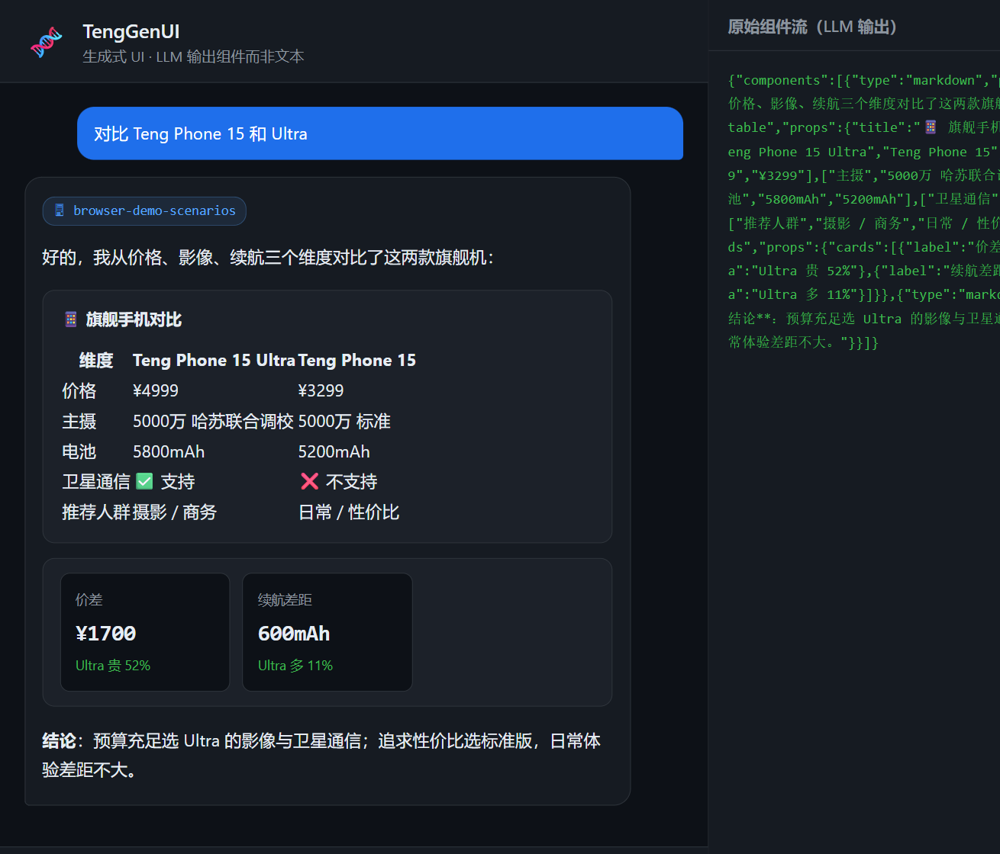
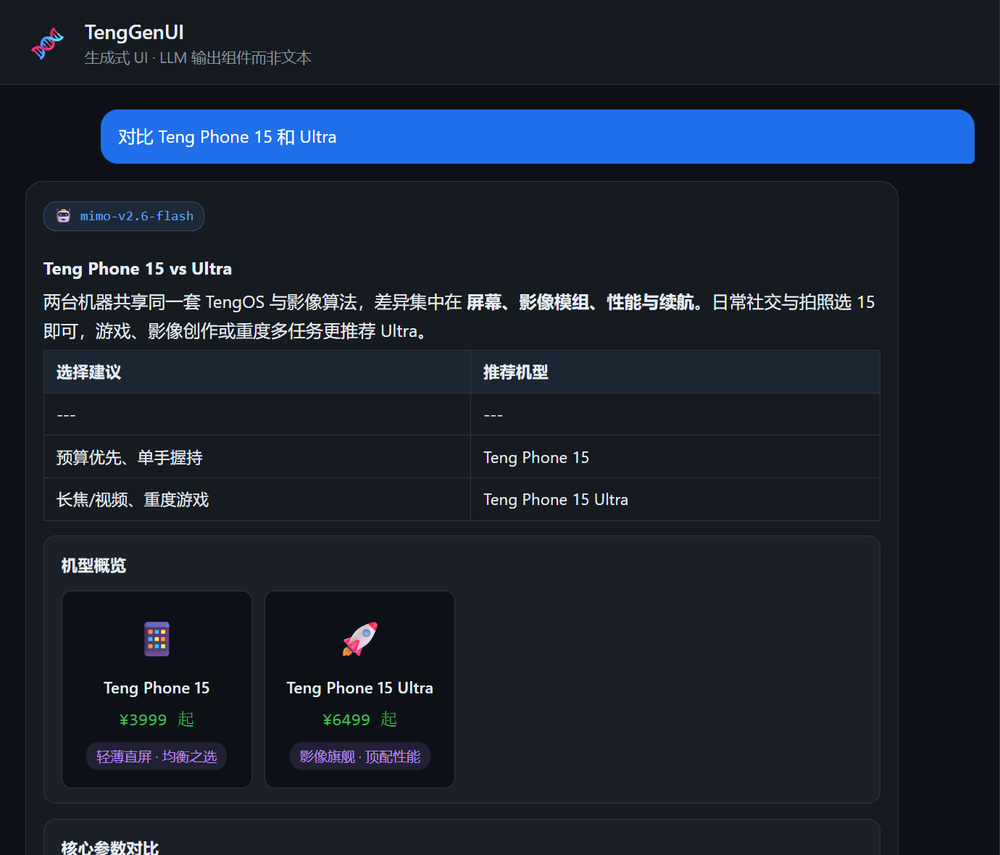
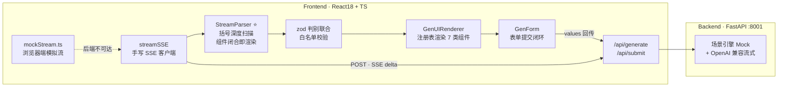

# 🧬 TengGenUI

**生成式 UI（Generative UI）演示台** — LLM 返回的不是文字，而是**结构化 UI 组件**：前端流式接收、边收边渲染，表格 / 卡片 / 图表 / 可交互表单逐块"点亮"。

> AI 前端面试双子星之二：如果说 [teng-agent-console](https://github.com/chaiwei-art/teng-agent-console) 讲的是"Agent 可观测性"，本项目讲的就是 **AI 原生交互范式**——生成式 UI 是 2026 年最前沿的 LLM 应用形态之一。

[](https://github.com/chaiwei-art/teng-genui/actions/workflows/ci.yml)
[](https://github.com/chaiwei-art/teng-genui/actions/workflows/pages.yml)


## 🖥 在线 Demo

**👉 [chaiwei-art.github.io/teng-genui](https://chaiwei-art.github.io/teng-genui)**（无需任何后端）

在线版自动探测后端可用性：后端可达 → 真实 LLM / Mock 场景引擎；不可达（GitHub Pages）→ **浏览器端同构模拟流**，与 FastAPI 后端产出相同事件序列，渲染路径零分叉。

## 📸 效果

**离线 Demo 模式（右侧面板为实时原始 JSON 流）：**



**真实模型（mimo-v2.6-flash）自由生成 7 类组件：**



## 🎯 核心思路

传统 LLM 应用：用户提问 → 返回 Markdown 文本 → 前端渲染文字。
生成式 UI：用户提问 → 返回**组件 JSON** → 前端渲染**可交互界面**。

```
用户："对比 Teng Phone 15 和 Ultra"
  ↓
LLM 输出（流式）：
{"components":[
  {"type":"markdown","props":{"text":"好的，三个维度对比："}},
  {"type":"product_table","props":{"columns":["维度","Ultra","15"],"rows":[...]}},
  {"type":"stat_cards","props":{"cards":[{"label":"价差","value":"¥1700"}]}}
]}
  ↓
前端边收边渲染 → 对比表格 + 统计卡片逐块出现
```

## ✨ 功能

- **🧪 Mock 场景引擎**：无需任何 API Key，按场景（对比/旅行/报表/推荐）返回组件方案，逐字符流式推送
- **📦 流式渐进渲染**：括号深度扫描解析器，组件闭合一个渲染一个，不等完整 JSON
- **🛡️ zod 白名单校验**：LLM 输出永远不可信；未通过 schema 的块直接丢弃，杜绝注入
- **📝 生成式表单**：LLM 动态生成表单（下拉/滑块/多选/日期），提交后回传 Agent 生成下一步 UI，形成闭环
- **🔬 原始流调试面板**：右侧实时展示 LLM 输出的原始 JSON，渲染过程完全透明
- **🛟 三层降级**：真实模型失败 → Mock；后端不可达 → 浏览器端模拟流；demo 永不白屏

## 🏗 技术架构



### 事件协议

```
meta   → { mode, model }    mode: real | mock | local
delta  → { text }           # 组件 JSON 的增量片段
usage  → { prompt_tokens, completion_tokens, total_tokens }
fallback → { reason, to }   # 真实模型失败降级
done   → {}
```

## 🚀 运行

### 方式一：在线（零依赖）

打开 [GitHub Pages](https://chaiwei-art.github.io/teng-genui)，即开即用（浏览器端模拟流）。

### 方式二：本地全栈

```bash
# 后端
cd backend
python -m venv .venv && .venv\Scripts\pip install -r requirements.txt
python -m uvicorn server:app --port 8001

# 前端（另开终端）
cd frontend
npm install
npm run dev     # http://localhost:5174（已代理 /api → :8001）
npm run build   # 生产构建（含 TypeScript 类型检查）
```

### 可选：接入真实模型

默认 Mock 场景引擎。设置环境变量后自动切换 OpenAI 兼容接口，失败自动降级：

```bash
setx OPENAI_API_KEY sk-xxx
setx OPENAI_BASE_URL https://your-gateway/v1   # 可选
setx GENUI_MODEL gpt-4o-mini                    # 可选
```

## 🧪 测试

```bash
# 后端 22 例：场景路由 / 表单闭环回传 / 流式事件序列 / delta 可重组性
cd backend && pip install -r requirements-dev.txt && pytest tests -q

# 前端 19 例：流式解析器（含真实 token 分片竞态的回归用例）/ zod 白名单边界
cd frontend && npm test
```

> 💬 解析器最关键的回归用例来自真实接入排查：`"components"` 与它的 `[` 跨 chunk 到达时的初始化竞态，Mock 固定分片无法复现、真实模型 token 分片必现——已固化为 7 种步长 + 逐字符的参数化测试。

## 🧪 试试这些输入

| 输入 | 渲染结果 |
|------|----------|
| `对比 Teng Phone 15 和 Ultra` | 对比表格 + 统计卡 |
| `帮我规划一次旅行` | **生成式表单** → 提交后生成行程步骤 + 花费统计 |
| `看看本季度销售数据` | 统计卡 + 柱状图 |
| `推荐一款通勤耳机` | 商品卡片组 |

## 🔧 技术亮点（面试可讲）

1. **流式结构化输出解析**：手写括号深度扫描器（跟踪字符串/转义状态），LLM 每吐一个完整组件就立即渲染，首屏时间从"收完整个 JSON"提前到"收到第一个组件"。
2. **zod 判别联合（discriminated union）做安全边界**：`type` 字段判别 7 种组件，字段长度/数量全设上限；坏块静默丢弃并计数——LLM 输出永远不可信。
3. **组件注册表模式**：新增组件类型只需写一个 React 组件 + 注册到 schema，渲染器零改动。
4. **生成式表单闭环**：表单由 LLM 动态生成 → 用户填写 → values 回传 `/api/submit` → Agent 生成下一步 UI。"UI 即接口"的完整演示。
5. **三层降级韧性**：真实模型 / Mock 引擎 / 浏览器端模拟流，同一事件协议，任何环境可用。

## 📁 目录结构

```
teng-genui/
├── backend/
│   ├── server.py            # FastAPI + SSE（/api/generate、/api/submit）
│   ├── genui.py             # Mock 场景引擎 + OpenAI 兼容流式 + 组件目录
│   ├── tests/               # pytest 22 例
│   └── requirements.txt / requirements-dev.txt
├── frontend/
│   ├── src/
│   │   ├── schema.ts                # zod 组件白名单（判别联合）
│   │   ├── lib/
│   │   │   ├── streamParser.ts      # ⭐ 流式 JSON 括号扫描解析器
│   │   │   ├── sse.ts               # 手写 SSE 客户端
│   │   │   ├── mockStream.ts        # 浏览器端同构模拟流
│   │   │   └── __tests__/           # vitest 19 例
│   │   ├── components/
│   │   │   ├── GenUIRenderer.tsx    # 注册表渲染器
│   │   │   └── blocks/              # 7 种组件实现
│   │   └── App.tsx                  # 对话主界面 + 原始流面板
│   └── vite.config.ts
└── .github/workflows/       # CI（测试+构建）/ Pages 部署
```

## 🤝 与 teng-agent-console 的关系

| | [teng-agent-console](https://github.com/chaiwei-art/teng-agent-console) | teng-genui（本项目） |
|---|---|---|
| 面试叙事 | Agent 可观测性（黑盒问题） | AI 原生交互范式（生成式 UI） |
| 技术栈 | Vue3 | React + TS + zod |
| 流式内容 | ReAct 推理链路 | 组件 JSON |
| 共同点 | 手写 SSE 客户端、流式渲染、三层降级、测试固化、零 UI 依赖 | 同左 |

两个项目合起来覆盖 AI 前端岗位的核心考点：**流式交互、结构化输出、AI 原生 UX、全栈工程素养**。

## License

MIT
